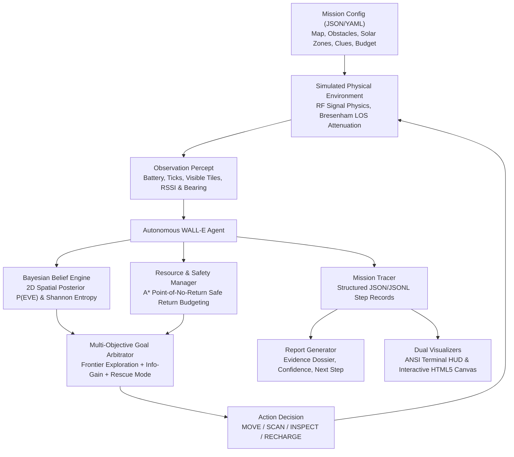

# 🤖 WALL-E and EVE's Signal: Autonomous Exploration System

An autonomous agent simulation where **WALL-E** explores a hazardous, obstacle-laden grid world, interprets noisy radio frequency (RF) signals and qualitative telemetry clues, manages a strictly constrained battery budget with solar recharging, updates a **2D Bayesian spatial belief map**, and localizes **EVE** to plan the recovery protocol.

---

## 🧭 System Architecture



---

## 📐 Mathematical Formulation

### 1. RF Propagation & Sensor Physics
Signal strength is modeled using the **Log-Distance Path Loss Model** augmented with obstacle shadowing:

$$S(d) = P_0 - 10 \eta \log_{10}(\max(d, 1)) - k \cdot \Delta_{\text{obs}} + \epsilon_{\text{rssi}}$$

Where:
- $P_0$: Reference signal power at 1 meter (default: $-20\text{ dBm}$)
- $\eta$: Path loss exponent ($\eta = 2.0$ in free space, $\eta \ge 2.2$ in cluttered scrap terrain)
- $d = \sqrt{(x_E - x_W)^2 + (y_E - y_W)^2}$: Euclidean distance from WALL-E to EVE
- $\Delta_{\text{obs}}$: Attenuation per obstacle along the direct line of sight (computed via Bresenham's algorithm)
- $k$: Obstacle count intersecting the line-of-sight ray
- $\epsilon_{\text{rssi}} \sim \mathcal{N}(0, \sigma^2)$: Gaussian measurement noise

Directional bearing angle $\theta$:

$$\theta = \operatorname{atan2}(y_E - y_W, x_E - x_W) + \epsilon_{\theta}, \quad \epsilon_{\theta} \sim \mathcal{N}(0, \sigma_\theta^2)$$

### 2. 2D Bayesian Spatial Belief Updating
WALL-E maintains a discrete 2D probability distribution $B_t(x, y) = P(\text{EVE} \text{ at } (x, y) \mid z_{1:t})$. Upon receiving measurement $z_t = (\text{RSSI}_t, \theta_t)$:

$$B_t(x, y) \propto B_{t-1}(x, y) \cdot L_{\text{rssi}}(x, y) \cdot L_{\text{bearing}}(x, y)$$

Where:
- $L_{\text{rssi}}(x, y) = \frac{1}{\sqrt{2\pi \sigma^2}} \exp\left(-\frac{(S_{\text{obs}} - \hat{S}(d))^2}{2\sigma^2}\right)$
- $L_{\text{bearing}}(x, y) = \frac{1}{\sqrt{2\pi \sigma_\theta^2}} \exp\left(-\frac{\Delta\theta^2}{2\sigma_\theta^2}\right)$

### 3. Qualitative Clue Conditioning
When WALL-E arrives adjacent to a clue marker and executes `INSPECT`, qualitative evidence updates the posterior:
- **Distance Bounds**: Discards or penalizes cells outside $[d_{\min}, d_{\max}]$.
- **Sector Elimination**: Discards discarded quadrants or coordinates ($P(x, y) = 0$).
- **Heading Cones**: Filters candidates outside bearing cones.
- **Status Telemetry**: Updates categorical belief over EVE's operational condition (`DORMANT_REBOOT_REQUIRED`, `DAMAGED_THRUSTER`, `LOW_POWER_BEACON`).

### 4. Shannon Entropy as Information Gain
Uncertainty across the search space is tracked via Shannon entropy:

$$H(B_t) = -\sum_{x=0}^{W-1} \sum_{y=0}^{H-1} B_t(x, y) \log_2(B_t(x, y) + 10^{-12})$$

As WALL-E triangulates and gathers clues, $H(B_t)$ collapses toward $0\text{ bits}$ (100% certainty).

### 5. Battery Safety & Point-of-No-Return Budgeting
To prevent stranding in the wasteland, WALL-E computes the shortest obstacle-free path to the nearest reachable solar recharge station $R^*$ using $A^*$:

$$\text{Cost}_{\text{return}} = \operatorname{dist}_{A^*}(W, R^*) \times \text{cost}_{\text{move}}$$

$$\text{Safety Threshold} = \text{Cost}_{\text{return}} + \text{Buffer}_{\text{margin}}$$

If $\text{Battery} \le \text{Safety Threshold}$, the agent enters **RETREAT_TO_RECHARGE** mode, prioritizing survival before resuming mission objectives.

---

## 🗂️ Project Structure

```
Wall-e/
├── configs/
│   ├── mission_01_basic.json           # Baseline open terrain triangulation
│   ├── mission_02_debris_field.json    # Scrap obstacle maze & occluded LOS
│   ├── mission_03_resource_scarce.json # Low battery (35%) requiring strategic recharge
│   └── mission_04_decoy_signals.json   # Malfunctioning rogue BnL decoy beacon
├── walle/
│   ├── config.py             # Schema definitions and JSON/YAML loader
│   ├── environment.py        # Physical world simulation, RF models, clues, battery
│   ├── belief.py             # 2D Bayesian spatial grid, entropy, clue fusion
│   ├── planner.py            # A* navigation, safe-return budgeting, target selector
│   ├── agent.py              # Autonomous decision loop with explicit reasoning
│   ├── logger.py             # Structured JSON/JSONL trace collector
│   ├── report.py             # Markdown and JSON mission report generator
│   ├── visualizer_ascii.py   # ANSI terminal visualizer with colored live HUD
│   └── visualizer_html.py    # Self-contained HTML5/Canvas interactive dashboard
├── tests/
│   ├── test_environment.py   # Physics, movement, collision, and clue tests
│   ├── test_belief.py        # Bayesian likelihood, entropy, and conditioning tests
│   ├── test_agent.py         # Battery-safe budgeting and decision tests
│   └── test_mission_e2e.py   # End-to-end full mission executions
├── traces/                   # Pre-generated traces, reports, and dashboards
├── run_mission.py            # Main CLI runner
├── benchmark.py              # Generalization benchmark across randomized seeds
├── visualizer.html           # Standalone interactive dashboard for latest mission
└── README.md                 # Complete documentation
```

---

## ⚡ Quickstart & Usage

### 1. Requirements
- **Python 3.8+** (Built with zero mandatory external dependencies; runs on Python standard library out-of-the-box).

### 2. Run a Mission
Execute the baseline mission with automatic trace, report, and HTML dashboard generation:

```bash
python3 run_mission.py --config configs/mission_01_basic.json
```

### 3. Live Terminal Visualization
Watch WALL-E explore the terrain in real-time with an ANSI colored ASCII map and telemetry HUD:

```bash
python3 run_mission.py --config configs/mission_02_debris_field.json --visualize
```

### 4. Interactive Web Dashboard
Open `visualizer.html` directly in any web browser (no web server needed):

```bash
open visualizer.html
```

#### Dashboard Features:
- 🎮 **Playback Controls**: Play, Pause, Step Forward/Back, Reset, and Speed toggles (1x, 2x, 5x).
- 🎚️ **Scrubber Slider**: Scrub back and forth across every step of the simulation.
- 🗺️ **Bayesian Heatmap Overlay**: Live toggle showing $P(\text{EVE})$ probability distribution across the grid.
- ⚡ **Telemetry HUD**: Real-time battery meter, Shannon entropy curve, and current action costs.
- 🧠 **Tactical Rationale Drawer**: Live card showing WALL-E's exact reasoning for every decision.
- 🔍 **Evidence Dossier & Report**: Tab to inspect gathered clues and full Markdown mission report.

### 5. Run All Unit Tests
Run the complete automated test suite (19 test cases):

```bash
python3 -m unittest discover tests -v
```

### 6. Run Generalization Benchmark
Evaluate the agent across 10 randomized procedural missions with varied seeds, scrap densities, and clue placements:

```bash
python3 benchmark.py --num-missions 10
```

---

## 📋 Mission Scenarios & Sample Results

| Scenario | Map | Constraints | Key Behavior | Outcome |
| :--- | :---: | :--- | :--- | :---: |
| **Mission 01: Initial Signal Beacon** | $12 \times 12$ | Baseline terrain, direct RF line-of-sight | Triangulates beacon, deciphers ion thruster heading, localizes EVE at `(10, 10)` | **SUCCESS** (67 steps) |
| **Mission 02: Scrap Debris Canyon** | $16 \times 16$ | Scrap maze, dense obstacles occluding signals | Navigates canyon walls using $A^*$, deciphers distance bound clue, finds EVE at `(14, 13)` | **SUCCESS** (33 steps) |
| **Mission 03: Dust Storm & Scarce Battery** | $16 \times 16$ | Initial battery: **35%**, long distance | Point-of-no-return triggered: halts exploration, retreats to solar station to recharge to 80%, resumes to `(14, 14)` | **SUCCESS** (43 steps) |
| **Mission 04: Rogue Decoy Beacon** | $16 \times 16$ | Malfunctioning BnL decoy at `(4, 12)` | Deciphers radio spectrum clue eliminating southern decoy sector, isolates true EVE at `(13, 3)` | **SUCCESS** (21 steps) |

---

## 📄 Mission Report Format

Every completed mission automatically produces:
1. `traces/<mission>_trace.json`: Full JSON array of every step's percepts, decisions, and belief states.
2. `traces/<mission>_trace.jsonl`: Streaming JSONL format for downstream pipelines.
3. `traces/<mission>_report.md`: Markdown report with Executive Summary, Evidence Dossier, Ground Truth verification, and recommended next moves.
4. `traces/<mission>_dashboard.html`: Mission-specific interactive visualizer.

### Sample Report Excerpt:
> **Tactical Directive:**  
> Initiate physical interface protocol at coordinates (10, 10). Connect auxiliary solar jumper cable and broadcast reboot authorization code 2105-A.

---

## 📜 License
MIT License. Built for the WALL-E and EVE Autonomous Exploration challenge.
