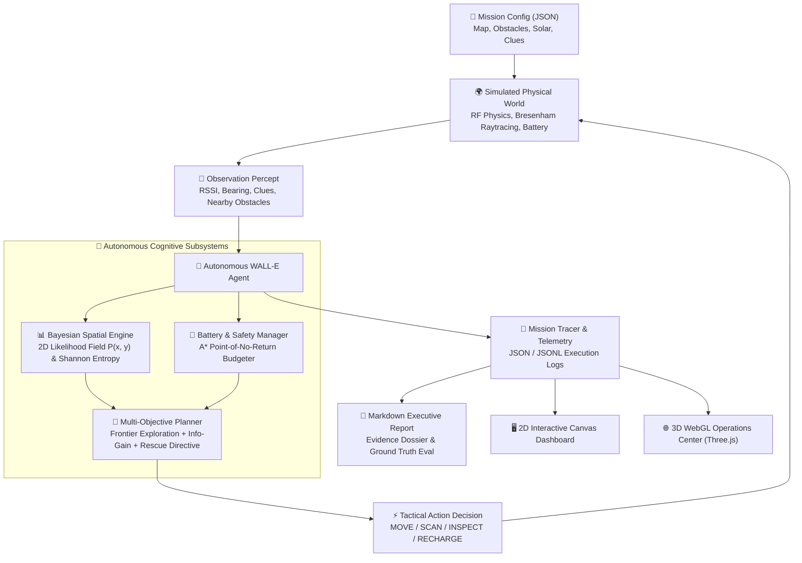
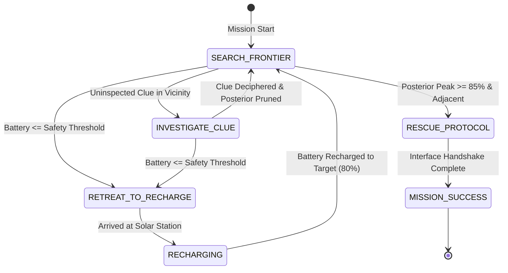

# 🤖 WALL-E and EVE's Signal: Autonomous Exploration System

<div align="center">

[](https://www.python.org/)
[](https://github.com/soham007-y/Wall-E)
[](https://github.com/soham007-y/Wall-E)
[](file:///visualizer_3d.html)
[](https://opensource.org/licenses/MIT)

**An autonomous AI agent simulating WALL-E in a hazardous, scrap-strewn wasteland.**  
*Triangulates noisy RF signals • Fuses qualitative clue heuristics • Updates a 2D Bayesian spatial belief map • Budgets battery safety margins via A\* • Localizes and rescues EVE.*

<br/>

[🚀 Quickstart](#-quickstart--run-modes) • [🌐 3D Operations Center](#-interactive-3d-webgl-operations-center) • [🧭 Architecture](#-system-architecture) • [📐 Math Engine](#-mathematical-formulation) • [📋 Mission Dossiers](#-interactive-mission-dossiers) • [📊 Benchmark](#-generalization-benchmark)

<br/>

</div>

---

## ⚡ Terminal Live HUD Preview

WALL-E features a real-time **ANSI Terminal HUD** that renders continuous spatial telemetry, battery levels, belief entropy, and robot reasoning directly to your console:

```text
┌─── MISSION STATUS: EXPLORING ───────────────────────────────────────────┐
│ Step: 042/100  │  Battery: [████████░░] 68%  │  Entropy: 0.42 bits      │
│ Target Conf: 98.4% at (10, 10)  │  Mode: LOCALIZING_SIGNAL              │
├─────────────────────────────────────────────────────────────────────────┤
│  .  .  .  .  .  .  .  .  .  .  .  .    [LEGEND]                         │
│  .  #  #  #  .  .  .  .  .  .  .  .    🤖 W : WALL-E (Current Position) │
│  .  #  S  #  .  .  .  .  .  .  .  .    💖 E : EVE (Estimated Beacon)   │
│  .  #  .  .  .  .  .  .  .  .  .  .    ⚡ S : Solar Recharge Station    │
│  .  .  .  .  .  .  .  .  .  .  .  .    🔍 ? : Uninspected Telemetry Clue│
│  .  .  .  .  .  .  🤖W .  .  .  .  .    🧱 # : Scrap / Debris Obstacle   │
│  .  .  .  .  .  .  .  .  .  .  .  .    ░ ▒ █: Bayesian Probability Field│
│  .  .  .  .  .  .  .  .  .  .  .  .                                     │
│  .  .  .  .  .  .  .  .  .  💖E .  .    Signal: -34.8 dBm (Bearing 128°)│
└─────────────────────────────────────────────────────────────────────────┘
[AGENT REASONING] Peak posterior probability concentrated in quadrant SE.
Path distance to solar station is safe (Cost: 6 units vs 68% battery reserve).
Executing MOVE [EAST] toward highest expected information gain.
```

---

## 🧭 System Architecture

The simulation is built modularly with zero external dependencies, decoupling physical simulation, Bayesian belief estimation, path planning, and dual rendering engines:



---

## 🎮 Interactive Decision State Machine

WALL-E uses a deterministic, safety-critical state machine that dynamically switches between information foraging, physical clue inspection, emergency solar retreat, and final rescue execution:



---

## 🚀 Quickstart & Run Modes

WALL-E requires only standard **Python 3.8+**. No `pip install` required!

### 1. Interactive Command Generator

<details open>
<summary><b>🛠️ Click to expand common execution recipes</b></summary>

| Intent | Command | What It Does |
| :--- | :--- | :--- |
| **Quick Run (Default)** | `python3 run_mission.py --config configs/mission_01_basic.json` | Runs baseline mission and produces full JSON trace, Markdown report, and HTML dashboards. |
| **Live ANSI Terminal** | `python3 run_mission.py --config configs/mission_02_debris_field.json --visualize` | Streams real-time ASCII map and live telemetry HUD directly to your terminal. |
| **Post-Mission Replay** | `python3 run_mission.py --config configs/mission_01_basic.json --replay` | Simulates mission first, then delivers interactive animated replay. |
| **Launch 3D Operations** | `open visualizer_3d.html` | Opens full 3D WebGL interactive visualization in your web browser. |
| **Launch 2D Dashboard** | `open visualizer.html` | Opens step-scrubbing 2D tactical mission visualizer in your web browser. |
| **Run Unit Tests** | `python3 -m unittest discover tests -v` | Executes complete test suite (19 test cases, <0.05s). |
| **Run Benchmark** | `python3 benchmark.py --num-missions 10` | Evaluates autonomous agent across 10 randomized procedural seeds. |

</details>

---

## 🌐 Interactive 3D WebGL Operations Center

Open [`visualizer_3d.html`](file:///Users/sohamyadav/Desktop/Wall-e/visualizer_3d.html) in any modern browser for an interactive mission control deck built with Three.js:

```bash
open visualizer_3d.html
```

<details open>
<summary><b>🕹️ Click to view 3D Operations Deck Features & Controls</b></summary>

### Key Capabilities:
- 🤖 **Articulated Procedural 3D Models**:
  - **WALL-E**: Articulated chassis with rubber tread tracks, dual binocular optical lenses, solar cell collector deck, and dynamic forward headlights with volumetric ground projection.
  - **EVE**: Floating glossy capsule with curved cyan visor, harmonic hovering animation, and ion thruster halo.
  - **Environment**: Towering solar recharge pylons with vertical light beams, scrap debris cubes, and holographic rotating clue beacons.
- 🌋 **3D Volumetric Bayesian Heatmap**:
  - Live 3D elevation surface rendered across the grid where mesh height and neon luminescence correspond to $P(\text{EVE} = (x, y))$. Watch probability peaks rise and flatten as new observations arrive!
- 🎥 **4 Dynamic Camera Views**:
  - `Free Orbit`: Left-click to rotate, right-click to pan, scroll to zoom in/out.
  - `Follow WALL-E`: Smooth third-person chase camera tracking behind the rover.
  - `Tactical Top-Down`: Bird's-eye orthographic tactical overview.
  - `WALL-E Lens`: First-person perspective looking out through WALL-E's binocular lenses.
- 🔊 **Procedural Web Audio Engine**:
  - Real-time synthesized audio: tread motor whirs, radar pings, clue decipher chimes, and solar hums (100% code-generated, zero audio files).
- 🎛️ **Scenario Switcher**:
  - Switch between all 4 mission environments directly from the top navigation dropdown without restarting.

</details>

---

## 🖥️ Interactive 2D Tactical Dashboard

Open [`visualizer.html`](file:///Users/sohamyadav/Desktop/Wall-e/visualizer.html) for a high-efficiency 2D tactical replay station:

```bash
open visualizer.html
```

<details>
<summary><b>📊 Click to expand 2D Dashboard capabilities</b></summary>

- ⏯️ **Precision Playback**: Play, Pause, Step Forward, Step Back, and Variable Speed (`1x`, `2x`, `5x`).
- 🎚️ **Interactive Timeline Scrubber**: Instantly jump to any simulation tick to inspect the exact historical state.
- 🗺️ **Bayesian Posterior Overlay**: Toggle heatmap visualization to inspect how probability density shifts over time.
- 🧠 **Live Cognitive Log**: Live card displaying WALL-E's exact internal rationale for every single action decision.
- 📑 **Integrated Mission Dossier**: Built-in tabs to read the generated Markdown mission report and evidence records.

</details>

---

## 📋 Interactive Mission Dossiers

Explore the four standard benchmark missions designed to test different facets of autonomy:

<details open>
<summary><b>🛰️ Mission 01: Initial Signal Beacon (Open Ground Triangulation)</b></summary>

- **Map Size**: $12 \times 12$
- **Obstacle Density**: Low (Open terrain)
- **Initial Battery**: $100\%$
- **Target Condition**: `DORMANT_REBOOT_REQUIRED` at `(10, 10)`
- **Challenge**: Baseline multi-point RF triangulation with clear line-of-sight.
- **Agent Solution**: Gathers early bearing and RSSI measurements, deciphers ion thruster heading clues, and converges onto EVE in 67 steps with 67% battery remaining.
- **Run Command**:
  ```bash
  python3 run_mission.py --config configs/mission_01_basic.json --visualize
  ```

</details>

<details>
<summary><b>🧱 Mission 02: Scrap Debris Canyon (Occluded Line-of-Sight & Maze)</b></summary>

- **Map Size**: $16 \times 16$
- **Obstacle Density**: High (Dense labyrinthian scrap walls)
- **Initial Battery**: $100\%$
- **Target Condition**: `LOW_POWER_BEACON` at `(14, 13)`
- **Challenge**: Bresenham ray-casting introduces severe RF shadowing through scrap piles. Direct paths are blocked.
- **Agent Solution**: Uses $A^*$ path planning to bypass scrap canyons while updating Bayesian likelihoods that account for obstacle count attenuation.
- **Run Command**:
  ```bash
  python3 run_mission.py --config configs/mission_02_debris_field.json --visualize
  ```

</details>

<details>
<summary><b>⚡ Mission 03: Dust Storm & Scarce Battery (Point-of-No-Return Survival)</b></summary>

- **Map Size**: $16 \times 16$
- **Obstacle Density**: Medium
- **Initial Battery**: **35%** (Critical constraint)
- **Target Condition**: `DAMAGED_THRUSTER` at `(14, 14)`
- **Challenge**: The distance to EVE exceeds total onboard battery. Careless exploration leads to terminal shutdown.
- **Agent Solution**: Dynamically computes $A^*$ return cost to the nearest solar station. When battery dips to safety threshold, halts mission, enters `RETREAT_TO_RECHARGE`, refills to 80%, and resumes search.
- **Run Command**:
  ```bash
  python3 run_mission.py --config configs/mission_03_resource_scarce.json --visualize
  ```

</details>

<details>
<summary><b>📡 Mission 04: Rogue Decoy Beacon (Adversarial False Positive)</b></summary>

- **Map Size**: $16 \times 16$
- **Obstacle Density**: Medium
- **Initial Battery**: $100\%$
- **Adversary**: Malfunctioning Buy-n-Large transmission beacon at `(4, 12)`
- **Target Condition**: True EVE located at `(13, 3)`
- **Challenge**: Bimodal probability distribution with two competing RF peaks.
- **Agent Solution**: Inspects physical telemetry clue at `(4, 4)` revealing decoy radio frequencies in the South quadrant. Posterior zeroing eliminates the decoy, isolating true EVE.
- **Run Command**:
  ```bash
  python3 run_mission.py --config configs/mission_04_decoy_signals.json --visualize
  ```

</details>

---

## 📐 Mathematical Formulation

<details>
<summary><b>1. RF Propagation & Obstacle Shadowing Physics</b></summary>

Signal strength is modeled using the **Log-Distance Path Loss Model** augmented with ray-cast obstacle attenuation:

$$S(d) = P_0 - 10 \eta \log_{10}(\max(d, 1)) - k \cdot \Delta_{\text{obs}} + \epsilon_{\text{rssi}}$$

Where:
- $P_0$: Reference power at 1 meter ($-20\text{ dBm}$)
- $\eta$: Path loss exponent ($\eta = 2.0$ in open air, up to $2.5$ in cluttered waste)
- $d = \sqrt{(x_E - x_W)^2 + (y_E - y_W)^2}$: Euclidean distance from WALL-E to EVE
- $\Delta_{\text{obs}}$: Attenuation per obstacle intersected along the direct line of sight (computed via Bresenham's algorithm)
- $k$: Count of scrap obstacle cells intersecting the line-of-sight ray
- $\epsilon_{\text{rssi}} \sim \mathcal{N}(0, \sigma^2)$: Gaussian sensor noise ($\sigma = 2.0\text{ dBm}$)

Directional bearing angle $\theta$:

$$\theta = \operatorname{atan2}(y_E - y_W, x_E - x_W) + \epsilon_{\theta}, \quad \epsilon_{\theta} \sim \mathcal{N}(0, \sigma_\theta^2)$$

</details>

<details>
<summary><b>2. 2D Recursive Bayesian Spatial Belief Updating</b></summary>

WALL-E maintains a discrete 2D spatial probability matrix $B_t(x, y) = P(\text{EVE} = (x, y) \mid z_{1:t})$. Upon receiving measurement vector $z_t = (\text{RSSI}_t, \theta_t)$:

$$B_t(x, y) \propto B_{t-1}(x, y) \cdot L_{\text{rssi}}(x, y) \cdot L_{\text{bearing}}(x, y)$$

Where:
- $L_{\text{rssi}}(x, y) = \frac{1}{\sqrt{2\pi \sigma^2}} \exp\left(-\frac{(S_{\text{obs}} - \hat{S}(d))^2}{2\sigma^2}\right)$
- $L_{\text{bearing}}(x, y) = \frac{1}{\sqrt{2\pi \sigma_\theta^2}} \exp\left(-\frac{\Delta\theta^2}{2\sigma_\theta^2}\right)$

Normalization guarantees $\sum_{x, y} B_t(x, y) = 1.0$.

</details>

<details>
<summary><b>3. Qualitative Clue Conditioning & Hypothesis Pruning</b></summary>

When WALL-E arrives adjacent to a clue marker and triggers `INSPECT`, qualitative evidence updates spatial and categorical beliefs:
- **Distance Bounds**: Prunes coordinates outside $[d_{\min}, d_{\max}]$.
- **Sector Elimination**: Sets excluded sectors/quadrants to zero: $P(x, y) = 0$.
- **Heading Cones**: Prunes candidate coordinates outside directional bearing wedges.
- **Status Telemetry**: Updates categorical belief over EVE's operational condition (`DORMANT_REBOOT_REQUIRED`, `DAMAGED_THRUSTER`, `LOW_POWER_BEACON`).

</details>

<details>
<summary><b>4. Shannon Entropy as Information Metric</b></summary>

System uncertainty across the 2D grid world is measured using **Shannon Entropy**:

$$H(B_t) = -\sum_{x=0}^{W-1} \sum_{y=0}^{H-1} B_t(x, y) \log_2(B_t(x, y) + 10^{-12})$$

- At $t=0$, entropy is maximized ($H \approx \log_2(W \times H)$ bits, representing uniform uncertainty).
- As WALL-E gathers RF percepts and deciphers clues, $H(B_t) \to 0.00\text{ bits}$, indicating a single, localized peak.

</details>

<details>
<summary><b>5. Battery Safety & Point-of-No-Return Budgeting</b></summary>

To prevent stranding, WALL-E evaluates the shortest traversable path to the nearest reachable solar station $R^*$ using $A^*$:

$$\text{Cost}_{\text{return}} = \operatorname{dist}_{A^*}(W, R^*) \times \text{cost}_{\text{move}}$$

$$\text{Safety Threshold} = \text{Cost}_{\text{return}} + \text{Buffer}_{\text{margin}}$$

If $\text{Battery} \le \text{Safety Threshold}$, the agent enters **RETREAT_TO_RECHARGE** mode, guaranteeing safe return before resuming exploration.

</details>

---

## 📊 Generalization Benchmark

Verify agent performance across arbitrary randomized procedural seeds with varying obstacle layouts, clue locations, and noise:

```bash
python3 benchmark.py --num-missions 10 --seed 42
```

### Benchmark Metric Tracking:
- 🎯 **Success Rate**: % of missions successfully localizing EVE.
- 📉 **Mean Entropy Reduction**: Total information gain across the run.
- ⚡ **Energy Efficiency**: Average battery margin preserved at mission end.
- 👣 **Path Optimality**: Total steps taken vs optimal theoretical shortest path.

---

## 🗂️ Repository Directory Structure

```
Wall-e/
├── configs/                            # Scenario definitions
│   ├── mission_01_basic.json           # Baseline open terrain triangulation
│   ├── mission_02_debris_field.json    # Scrap obstacle maze & occluded LOS
│   ├── mission_03_resource_scarce.json # Low battery (35%) requiring strategic recharge
│   └── mission_04_decoy_signals.json   # Malfunctioning rogue BnL decoy beacon
├── walle/                              # Autonomous Agent Core Package
│   ├── config.py                       # Configuration loader and validator
│   ├── environment.py                  # Physical world simulation & RF signal physics
│   ├── belief.py                       # 2D Bayesian spatial grid & entropy calculator
│   ├── planner.py                      # A* path planner & battery safety budgeter
│   ├── agent.py                        # Autonomous decision loop with cognitive rationale
│   ├── logger.py                       # Structured JSON/JSONL telemetry logger
│   ├── report.py                       # Markdown executive summary generator
│   ├── visualizer_ascii.py             # ANSI terminal live HUD
│   ├── visualizer_html.py              # Self-contained 2D Canvas interactive dashboard
│   └── visualizer_3d.py                # Standalone 3D Three.js WebGL operations center
├── tests/                              # Comprehensive Unit Test Suite
│   ├── test_environment.py             # Physics, movement, collision, and clue tests
│   ├── test_belief.py                  # Bayesian likelihood, entropy, and conditioning
│   ├── test_agent.py                   # Battery-safe budgeting and decision tests
│   └── test_mission_e2e.py             # Full end-to-end mission test cases
├── vendor/                             # Bundled offline visualizer libraries
│   ├── three.min.js                    # Three.js 3D rendering library
│   └── OrbitControls.js                # Camera orbital interaction controller
├── traces/                             # Generated telemetry traces and reports
├── run_mission.py                      # Primary CLI mission runner
├── benchmark.py                        # Multi-seed procedural evaluation runner
├── visualizer.html                     # Root 2D interactive dashboard
├── visualizer_3d.html                  # Root 3D WebGL operations center
└── README.md                           # Documentation & flight manual
```

---

## 📋 Pre-Flight Mission Checklist

- [x] Python 3.8+ runtime verified
- [x] Zero external third-party dependencies required
- [x] All 19 unit tests passing cleanly
- [x] RF Path Loss & Bresenham attenuation calibrated
- [x] Point-of-No-Return battery safety threshold active
- [x] 3D WebGL operations center bundled with local vendor libraries
- [x] Automated Markdown reporting with ground-truth verification enabled

---

## 📜 License

Distributed under the **MIT License**. See `LICENSE` for more information. Built for the WALL-E and EVE Autonomous Exploration challenge.
